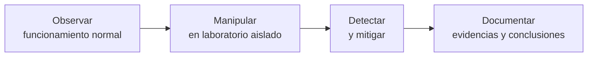

<div align="center">

# 🛡️ Cybersecurity Roadmap

**Laboratorio personal de ciberseguridad práctica: de los fundamentos de red a la detección y respuesta.**


[Roadmap completo](ROADMAP.md) · [Progreso](progress/progress.md) · [Glosario](glossary/) · [Plantillas](templates/)

</div>

---

## 📖 Descripción

Repositorio de estudio autodidacta de ciberseguridad. Cada experimento tiene un objetivo técnico, los conceptos que aplica, evidencias observables (capturas, logs, comandos) y una conclusión que incluye detección y mitigación.

El orden aprovecha conocimientos previos de redes, Linux y desarrollo web (React, Next.js, NestJS, TypeORM, PostgreSQL), sin asumir dominio previo de análisis de protocolos ni de explotación de vulnerabilidades.

## 🧭 Metodología



Cada experimento sigue este ciclo. La parte defensiva no es opcional: todo ataque reproducido incluye análisis de evidencias y mitigaciones.

## 🗺️ Estructura del roadmap

| Fase | Tema | Experimentos | Resultado esperado |
|:----:|------|:------------:|--------------------|
| 1 | [Fundamentos y análisis de redes](phases/01-network-fundamentals/) | EXP-001 – 008 | Abrir una captura de Wireshark y explicar qué ocurre, y distinguir tráfico normal de una anomalía |
| 2 | [Ataques y seguridad de redes](phases/02-network-attacks/) | EXP-009 – 016 | Explicar qué condición permitió una interceptación, qué quedó expuesto y qué la habría evitado |
| 3 | [Seguridad web y APIs](phases/03-web-security/) | EXP-017 – 026 | Reproducir, explicar y corregir en código vulnerabilidades web comunes |
| 4 | [Seguridad de Linux y servicios](phases/04-linux-security/) | EXP-027 – 033 | Auditar un Linux propio y endurecerlo sin romper servicios legítimos |
| 5 | [Detección y respuesta](phases/05-detection-response/) | EXP-034 – 039 | Construir un flujo de detección que genere alertas justificadas |
| 6 | [Proyecto integrador](phases/06-capstone/) | EXP-040 | Informe técnico reproducible de un entorno propio |

Detalle completo de cada experimento en [`ROADMAP.md`](ROADMAP.md).

## 📊 Progreso

| Fase | Completados | Avance |
|------|:-----------:|--------|
| 1. Fundamentos de red | 0 / 8 | ░░░░░░░░░░ 0% |
| 2. Ataques de red | 0 / 8 | ░░░░░░░░░░ 0% |
| 3. Seguridad web | 0 / 10 | ░░░░░░░░░░ 0% |
| 4. Linux | 0 / 7 | ░░░░░░░░░░ 0% |
| 5. Detección y respuesta | 0 / 6 | ░░░░░░░░░░ 0% |
| 6. Proyecto integrador | 0 / 1 | ░░░░░░░░░░ 0% |
| **Total** | **0 / 40** | ░░░░░░░░░░ **0%** |

Registro detallado en [`progress/progress.md`](progress/progress.md).

## 🧪 Entorno de laboratorio

Todas las pruebas se ejecutan en un entorno propio y aislado.

| Componente | Herramienta |
|------------|-------------|
| Virtualización | VirtualBox / VMware / KVM *(completar)* |
| Red | Red virtual aislada (host-only / internal), sin salida a Internet para las prácticas ofensivas |
| Sistema objetivo | Linux (distribución a definir) |
| Aplicación vulnerable | OWASP Juice Shop o API de laboratorio propia |
| Análisis de red | Wireshark, tcpdump |
| Proxy web | Burp Suite / OWASP ZAP |
| Detección | Suricata o Snort, journalctl, Python |

## 📂 Estructura del repositorio

```
cybersecurity-roadmap/
├── README.md
├── ROADMAP.md
├── glossary/                  # Definiciones de conceptos y términos
├── phases/
│   ├── 01-network-fundamentals/
│   ├── 02-network-attacks/
│   ├── 03-web-security/
│   ├── 04-linux-security/
│   ├── 05-detection-response/
│   └── 06-capstone/
├── templates/
│   ├── experiment.md          # Plantilla de experimento
│   └── concept.md             # Plantilla de concepto
└── progress/
    └── progress.md            # Registro de avance
```

## 🧾 Formato de cada experimento

Cada experimento se documenta con la plantilla [`templates/experiment.md`](templates/experiment.md):

1. **Objetivo**: qué se quiere comprender o demostrar.
2. **Conceptos aplicados**: referencias al glosario.
3. **Entorno y alcance**: máquinas, red y versiones usadas.
4. **Procedimiento**: comandos y pasos reproducibles.
5. **Evidencias**: capturas, logs, salidas de comandos.
6. **Análisis**: qué ocurrió y por qué.
7. **Detección**: señales que permiten identificarlo.
8. **Mitigación**: controles que cambian el resultado.
9. **Conclusiones**: aprendizajes y límites.

## ⚠️ Aviso legal y ético

- Todo el contenido tiene fines **educativos**.
- Las técnicas ofensivas se aplican **exclusivamente** sobre máquinas y redes propias, en entornos virtuales aislados.
- No se realizan pruebas contra sistemas, redes o servicios de terceros sin autorización explícita y por escrito.
- Las aplicaciones vulnerables utilizadas **no deben exponerse a Internet**.
- El autor no se responsabiliza por el uso indebido de la información de este repositorio.

## 📚 Recursos

- [OWASP Top 10](https://owasp.org/www-project-top-ten/)
- [OWASP Juice Shop](https://owasp.org/www-project-juice-shop/)
- [Wireshark Documentation](https://www.wireshark.org/docs/)
- [MITRE ATT&CK](https://attack.mitre.org/)
- [NIST Cybersecurity Framework](https://www.nist.gov/cyberframework)

## 📄 Licencia

Distribuido bajo licencia MIT. Ver [`LICENSE`](LICENSE).

---

<div align="center">

**Autor:** [@TU-USUARIO](https://github.com/TU-USUARIO)

</div>